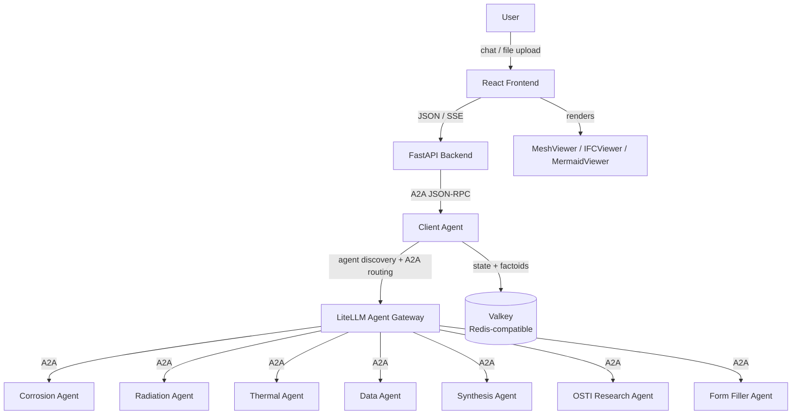

# Prometheus Platform

A multi-agent analysis platform for engineering and science. Users interact through a React chat UI (served by a FastAPI backend) that routes queries to specialist agents via a central client-agent orchestrator. The platform supports 3D visualization (Exodus, STL, IFC), multi-step analysis workflows, conversation state, and a DeepLynx-backed artifact catalog.

## Architecture



**Request flow:** A user sends a message in the React frontend, which posts it to the FastAPI backend over its JSON/SSE contract. The backend forwards it as an A2A JSON-RPC request to the client-agent, which classifies the query, discovers relevant specialist agents through LiteLLM's agent directory, collects any missing parameters, builds an execution plan, and dispatches work through LiteLLM's A2A gateway. Results (including artifacts) flow back through the client-agent and backend to the frontend for rendering.

## Prerequisites

- Docker with Compose. On Windows, run everything from a WSL2 distro; see
  [Windows + WSL2 setup](docs/docs/windows-wsl2-setup.md).
- `make` and `openssl`. On RHEL-based distros: `sudo dnf groupinstall "Development Tools"` and
  `sudo dnf install openssl`.
- Python 3, used by the setup scripts.
- For Kubernetes only: [k3d](https://k3d.io/stable/#installation),
  [kubectl](https://kubernetes.io/docs/tasks/tools/), [Helm](https://helm.sh/docs/intro/install/)
  and [Tilt](https://docs.tilt.dev/install.html).

## Quickstart

### 1. Configure the environment

```bash
cp .env.example .env
```

In `.env`, set `LLM_CONFIG_PROFILE` and `LLM_API_KEY`. The comments in `.env.example` list the
providers.

### 2a. Run with Docker Compose

```bash
echo "LOCAL_SDK=true" >> .env
make up
```

The first run builds every image and takes 5 to 15 minutes. Open http://localhost:5150 and create
your login. Stop the stack with `make down`.

### 2b. Run on a local Kubernetes cluster

```bash
make cluster-up
make build LOCAL_SDK=true PROFILE=prod
make cluster-push
make cluster-deploy PROMETHEUS_IMAGE_REGISTRY=k3d-prometheus-registry.localhost:5001 PROMETHEUS_IMAGE_TAG=local
```

This creates a one-node k3d cluster and installs the stack with the Helm chart in
`../infrastructure/helm/prometheus/`. Open http://localhost:8080 and create your login.

Behind a TLS-inspecting proxy, add `EXTRA_CA_CERT=/path/to/ca.pem` to `make cluster-deploy`.

```bash
make cluster-status             # list the pods
make cluster-logs SVC=backend   # follow one service's logs
make cluster-down               # delete the cluster
```

## Setup details

### Secrets

The first start fills in every blank secret in `.env`. Back up `.env` after that: without it, the
encrypted data in the admin database can't be read. See
[Encryption and keys](docs/docs/dev-docs/encryption-and-keys.md).

### Base image

Every agent is built on a shared image that contains the Prometheus SDK. There are two ways to
get it:

- **Build it yourself.** This is what `LOCAL_SDK=true` in the Quickstart does. It builds the image
  from the `sdk/` folder in this repo and needs no account.
- **Download it from INL.** Remove `LOCAL_SDK=true` from `.env` and log in to INL's container
  registry once, using an [INL GitHub token](https://github.inl.gov/settings/tokens/new) with the
  `read:packages` permission:

  ```bash
  docker login containers.github.inl.gov --username <your-github-username>
  ```

### Everyday commands

```bash
make up      # start the stack
make logs    # follow the logs
make down    # stop the stack
```

## Local frontend development (hot reload)

The React frontend supports hot reload against an already-running Compose stack:

```bash
# 1. Start the stack. The backend is published on 8600 regardless of PROFILE.
#    Use PROFILE= to skip the containerized frontend so it doesn't hold port 5150.
make PROFILE= up

# 2. Run the Vite dev server locally.
cd frontend
make install
make dev           # http://localhost:5150
```

The Vite dev server proxies `/api` to the backend at `VITE_BACKEND_URL` (default `http://localhost:8600`), which maps to the containerized backend.

## Full-system tests

Full-system tests exercise the same LLM-driven planning, parameter requests, specialist agents, and artifacts as the frontend. They never start or reconfigure Docker. Start the full platform with the client-agent host port enabled, then run the suite separately:

```bash
make PROMETHEUS_SYSTEM_TESTING=true up
make test-system
```

`tests/system/prometheus.py` provides concise test helpers for starting a chat, prompting, submitting requested parameters, approving plans, inspecting typed artifacts, and making LLM-judged semantic assertions. It wraps the lower-level lifecycle stream and production artifact APIs in `tests/system/a2a_client.py`.

## Configuration

### Services and ports

| Service            | URL / Port                                               | Role                                              |
| ------------------ | -------------------------------------------------------- | ------------------------------------------------- |
| React frontend     | http://localhost:5150, or 8080 with `PROFILE=prod`       | Entry point                                       |
| Backend (FastAPI)  | http://localhost:8600                                    | JSON/SSE API + auth/sessions                      |
| Client agent       | internal only; http://localhost:8001 in system-test mode | Orchestrator                                      |
| LiteLLM gateway    | http://localhost:9977                                    | Agent registry + LLM proxy                        |
| Valkey             | localhost:6379                                           | Redis-compatible state, status, artifact metadata |
| Postgres (LiteLLM) | internal only                                            | Persistent agent registrations                    |

### Backend settings

Backend settings come from `backend/app/config.yml` (override the path with `PROMETHEUS_CONFIG_PATH`):

| Key                    | Description                                                                                     |
| ---------------------- | ----------------------------------------------------------------------------------------------- |
| `agent-url`            | Client-agent A2A endpoint (default: `http://localhost:8001`). Overridden by `CLIENT_AGENT_URL`. |
| `agent-secret`         | Bearer token for agent auth. Overridden by `AGENT_SECRET`.                                      |
| `redis-url`            | Redis connection URL for session/conversation state. Overridden by `REDIS_URL`.                 |
| `jwt-secret`           | Session-cookie signing key. Overridden by `BACKEND_JWT_SECRET`.                                 |
| `debug`                | Enable debug features                                                                           |
| `auto-approve-steps`   | Skip manual approval between workflow steps                                                     |
| `workflow-suggestions` | Chat suggestions shown on startup                                                               |

The React app itself is configured through `frontend/config.ts` and `VITE_*` environment variables (e.g. `VITE_BACKEND_URL`).

Notable environment variables (see `.env.example` for the full list):

| Variable                                  | Purpose                                                                                                                                              |
| ----------------------------------------- | ---------------------------------------------------------------------------------------------------------------------------------------------------- |
| `LLM_CONFIG_PROFILE`                      | LLM provider; `.env.example` lists the values                                                                                                        |
| `LLM_CONFIG_FILE`                         | Optional custom YAML path inside the agent container; overrides `LLM_CONFIG_PROFILE`                                                                 |
| `DEBUG_AGENTS`                            | When `true`, also build and start the mock agents in `agents/debug-agents/`                                                                          |
| `OPTIONAL_AGENTS`                         | When `true`, also build and start the heavy agents in `agents/optional/` (OSTI research; its PDF/ML dependencies make it the slowest image to build) |
| `PROMETHEUS_SYSTEM_TESTING`               | When `true`, Make includes the Compose override that publishes the client-agent on `CLIENT_AGENT_PORT`                                               |
| Provider API keys                         | Credentials referenced by the selected profile; see `.env.example`                                                                                   |
| `AGENT_SECRET_REQUIRED`                   | Enforce Bearer auth on specialist agents (default `true`)                                                                                            |
| `LOCAL_CERT_FILE` / `CERT_FILE`           | CA bundle path on host / inside containers                                                                                                           |
| `HTTP_PROXY` / `HTTPS_PROXY` / `NO_PROXY` | Corporate proxy settings                                                                                                                             |

### Optional integrations (work in progress)

**DeepLynx** — storage catalog for artifact payloads and `deeplynx://` URI resolution (required for the artifact-debug-agent and a handful of specialist flows). Configure with `DEEPLYNX_BASE_URL`, `DEEPLYNX_KEY`, `DEEPLYNX_SECRET`, `DEEPLYNX_ORG_ID`, `DEEPLYNX_PROJECT_ID`. Instructions to configure a local DeepLynx server can be found [here](docs/docs/local-deeplynx.md).

**OIDC single sign-on** — alternative to the local-users login. Providers are *not* configured by environment variable: an admin registers each one at runtime through the in-app admin UI (`POST /api/admin/oidc-providers`), which stores it in admin-db with the client secret encrypted at rest. Login then lives at `GET /api/auth/login/{provider_id}`. See `docs/docs/dev-docs/multi-user-setup.md`.

## Project structure

```
platform/
  Makefile                  # Top-level orchestration (Compose, generate, tests)
  docker-compose.yml        # Core infra: Valkey, LiteLLM, Postgres, client-agent, backend, frontend
  docker-compose.agents.yml # Auto-generated from agents/*/docker-compose.yml — do not edit
  litellm_config.yaml       # LiteLLM proxy config (model_list, master key, db url)
  scripts/
    generate-agents-compose.sh
  backend/
    app/                    # FastAPI app: routers, services, contract, config
    tests/
  frontend/                 # React + Vite single-page app
    src/                    # App, components, viewers, lib (backend contract adapter)
    public/                 # Static assets, custom-element JSX, IFC/VTK JS bundles
    Dockerfile              # dev (Vite) + prod (nginx) build stages
    nginx/                  # prod nginx template (SPA, /api proxy via $BACKEND_UPSTREAM, /healthz)

  agents/
    client-agent/           # A2A orchestrator
    optional/               # heavy agents, only with OPTIONAL_AGENTS=true
      osti-research-agent/  # OSTI literature search (PDF/ML deps, slow build)
    form-filler-agent/      # Dynamic form completion
    artifact-debug-agent/   # Artifact handling test agent
    (debug) corrosion-agent/        # Corrosion analysis specialist
    (debug) radiation-agent/        # Radiation damage specialist
    (debug) thermal-agent/          # Thermal analysis specialist
    (debug) material-data-agent/    # Material data retrieval
    (debug) synthesis-agent/        # Report synthesis

  tests/                    # Infrastructure / integration tests for the full stack
  docs/                     # Project documentation (Zensical site)
```

## Development

### Agent discovery

`make up` scans `agents/*/docker-compose.yml` and writes `docker-compose.agents.yml`, so don't edit
that file by hand. Agents in `agents/debug-agents/` and `agents/optional/` are included only with
`DEBUG_AGENTS=true` and `OPTIONAL_AGENTS=true`.

On Kubernetes, each agent also needs an `agents/<name>/helm-values.yaml`. The chart's
`values.yaml` documents the settings.

### Frontend (`frontend/Makefile`)

```bash
cd frontend

make install     # npm install
make dev         # Vite dev server on port 5150 (hot reload)
make build       # Production bundle → dist/
make lint        # eslint
make typecheck   # tsc
make check       # lint + typecheck
```

The Vite dev server proxies `/api` to the backend (`VITE_BACKEND_URL`, default `http://localhost:8600`). React unit tests live alongside the source as `src/**/*.test.ts`.

### Per-agent

Each agent has its own `pyproject.toml`; the client-agent additionally ships a `tests/` suite. Run from the agent directory:

```bash
cd agents/client-agent
uv sync
PYTEST_DISABLE_PLUGIN_AUTOLOAD=1 uv run python -m pytest -p pytest_asyncio.plugin tests
```

### Infrastructure tests (`tests/`)

```bash
make test-static       # Static checks of compose, env vars, ports — no Docker needed
make test-integration  # Hits running containers (start the stack first via make up)
make test-infra        # Both
```

### Startup check

`make up` returns only once the platform is up. It first waits for every service with a healthcheck to report healthy (`docker compose up --wait`), then runs `make check`. That checks the backend and frontend on their host ports, the frontend's `/api` proxy, and that the client-agent and every included agent have registered with LiteLLM. `restart`, `ng-up` and `ng-restart` do the same, and the `-fg` targets can't, since they never return. Set `CHECK=false` to return as soon as the containers start, and run `make check` later against a running stack. CI's `platform: up` job runs the same `make up`.

A healthy agent shows only that it serves HTTP. LiteLLM registration runs in the background, so `make check` is what confirms that the platform can route to the agent. Every per-agent `docker-compose.yml` must define a healthcheck on the base class's health endpoint, and `make test-static` enforces it.

## Troubleshooting

**Forgot your password.** With the platform running, delete the local user accounts and refresh
the app. You are prompted to create a new username and password.

```bash
make clear-admin-users
```

**Reinstalled, or lost `.env`.** The old volumes still use the old database passwords, and their
rows are encrypted with the old key, so the backend can't connect. `make clobber` deletes those
volumes, including all users, keys and history, so the next `make up` starts fresh.

## Documentation

- [Windows + WSL2 setup](docs/docs/windows-wsl2-setup.md) - installing and verifying Docker Desktop's WSL2 integration before running `make up`
- [Architecture](docs/docs/dev-docs/architecture.md)
- [Client-agent developer guide](agents/client-agent/README.md)
- [Adding agents](docs/docs/dev-docs/adding-agents.md)
- [Artifacts](docs/docs/dev-docs/artifacts.md)
- [Multi-user setup](docs/docs/dev-docs/multi-user-setup.md) - identity JWTs, credential broker, running single-user without signing keys
- [Visualization plugins](docs/docs/dev-docs/visualization-plugins.md)
- [Migration guide](docs/docs/dev-docs/migration.md) - what changed from the original projects and why
- [Self-hosted DeepLynx](docs/docs/local-deeplynx.md) - roll out your own DeepLynx instance and connect the platform to it
